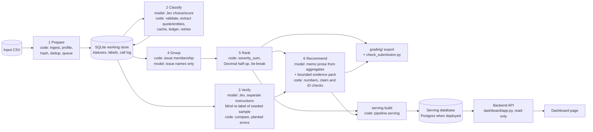

# Spotify Insight Pipeline (MBA 290T, Assignment 5)

A staged, auditable pipeline that turns 660,622 public Spotify Google Play reviews
(May 2022 – November 2023) into a product-priority recommendation backed by traceable evidence.
Code owns record accounting, validation, caching, budgets and arithmetic; models only read
language (classification, independent verification, issue naming, memo prose).

> **Status (2026-10-12): final analysis complete; dashboard not yet deployed.** Ingestion is complete
> for all 660,622 rows. The large-scale classification run finished at its cumulative $4.00 cap with
> 284,709 reviews classified (every duplicated text plus 92,367 single texts in seeded order; 375,900
> pending, 13 quarantined). The golden-50 evaluation, interruption/resume demonstration, independent
> verifier, injection test, measured cold/warm pilot, issue naming, [memo](outputs/analysis/memo.md)
> and recommendations are done, and the [grading export](grading/) passes the provided checker except
> for the disclosed coverage gap. Still to come: deployment of the dashboard (built and tested
> locally; see [`dashboard/`](dashboard/)) and the recording link. Everything labeled *measured* below comes from saved run files; anything produced by
> mock models in tests is labeled *synthetic* and is never reported as a result.

| Item | Location / status |
|---|---|
| Live dashboard | Not deployed yet; database loaded in Neon Postgres and verified; code in [`dashboard/`](dashboard/) (backend API + page) |
| Grading export | [`grading/`](grading/) (final, 2026-10-12; provided checker: only `missing_records` / `unfinished_classification` for the 375,900 pending reviews) |
| Ingestion report | [`outputs/ingestion/ingestion_report.json`](outputs/ingestion/ingestion_report.json) |
| Enrichment run logs | [`outputs/runs/`](outputs/runs/) (`run_summary.json`, `progress.jsonl`, `run_log.jsonl` per run) |
| Interruption/resume evidence | [`outputs/checkpoints/`](outputs/checkpoints/), [`evals/system/resume_evidence.json`](evals/system/resume_evidence.json), screen recording (link to be added) |
| Golden-50 evaluation | [`evals/golden/`](evals/golden/) (aggregate metrics; per-case file pending a publication decision) |
| Final analysis | [`outputs/analysis/`](outputs/analysis/): [memo](outputs/analysis/memo.md), [recommendations](outputs/analysis/recommendations.json), ranking, trends, weighted comparison, [run manifest](outputs/analysis/run_manifest.json) |
| Verification and injection results | [`evals/verification/`](evals/verification/), [`evals/injection/`](evals/injection/) |
| Preliminary analysis (analysis_10000) | [`outputs/analysis_preview_10000/`](outputs/analysis_preview_10000/) |
| Final-run workflow | [`pipeline/finalize.py`](pipeline/finalize.py): stage → export → provided checker → serving DB → promote (never overwrites); [submission checklist and contract audit](docs/SUBMISSION_CHECKLIST.md) |
| Cost/runtime calculator | [`cost/`](cost/) (measured cold/warm pilot; offline replay works without a key) |
| Label definitions and examples | [`docs/GOLDEN_LABELING_GUIDE.md`](docs/GOLDEN_LABELING_GUIDE.md), [`GRADING_CONTRACT.md`](GRADING_CONTRACT.md) |

## Rubric evidence map

| Rubric criterion | Evidence | Status |
|---|---|---|
| **Deliverable quality 1** – accessible code/setup and artifacts | [Setup](#setup), [Commands](#commands), standard-library-only code in [`pipeline/`](pipeline/) | Done |
| **Deliverable quality 2** – architecture, shared schema, provenance | [Architecture](#architecture), [`pipeline/labels.py`](pipeline/labels.py) (schema, prompts, `label_config`), row hashes via the provided `row_sha` | Done |
| **Deliverable quality 3** – memo numbers linked to calculations and evidence | [`pipeline/insights.py`](pipeline/insights.py): code inserts every number from `ranking.csv`, claim IDs map to `claims.csv`, cited review IDs are checked | Done ([memo](outputs/analysis/memo.md), [claims](grading/claims.csv)) |
| **Deliverable quality 4** – recommendation, alternatives, limitations | Memo sections are enforced by code (Recommendation, Evidence, Alternatives considered, Limitations) | Done |
| **Testing 1** – 50 human labels, per-field comparison, error analysis | [`evals/golden/metrics.json`](evals/golden/metrics.json), [`evals/golden/disagreement_patterns.json`](evals/golden/disagreement_patterns.json), [`pipeline/golden_eval.py`](pipeline/golden_eval.py) | Done (measured) |
| **Testing 2** – independent verification, planted-error and injection tests | [`pipeline/verify.py`](pipeline/verify.py) (blind re-label of a declared seeded sample, separate instructions), planted-error test copy, [`evals/injection_cases.csv`](evals/injection_cases.csv) | Done (measured; see [Verification](#independent-verification-and-injection-test)) |
| **Testing 3** – real 100-review cold/warm pilot, calculator, retry/spend/recovery controls | [`pipeline/pilot.py`](pipeline/pilot.py), [`cost/`](cost/); controls: shared spend ledger with reservations, retries, network-outage recovery, supervisor, resume ([`tests/test_resilience.py`](tests/test_resilience.py)) | Done (measured pilot; see [Pilot](#measured-100-review-coldwarm-pilot)) |
| **Working result 1** – full ingestion, coverage, classification | Ingestion: 660,622/660,622 accounted for; classification: 284,709 completed, 375,900 pending (budget), 13 quarantined | Done within the approved budget; coverage disclosed |
| **Working result 2** – staged program, bounded calls, saved handoffs, resume | [`pipeline/run.py`](pipeline/run.py) runs all stages from an input CSV; 1 review per request; resume demonstrated ([evidence](evals/system/resume_evidence.json)) | Done |
| **Working result 3** – reproducible ranking, deployed dashboard with AI recommendations | `python3 -m pipeline.rank` regenerates the ranking from saved files; [`dashboard/`](dashboard/) serves metrics, ranking, evidence reviews and AI recommendations from a database ([`pipeline/serving.py`](pipeline/serving.py), [`tests/test_dashboard.py`](tests/test_dashboard.py)) | Ranking done (regenerated byte-for-byte from `grading/`); dashboard built and tested on the final data locally; deployment pending |

## Results (measured)

### Ingestion (all 660,622 rows)

Input `spotify_reviews_18months.csv`, 97,400,616 bytes, SHA-256
`1fc85de68a304dd8978b537cfa58793d5f41cbaf417fa32cb53899f83a2fcef6`.

| Metric | Value |
|---|---|
| Source rows / unique review IDs | 660,622 / 660,622 (0 duplicate IDs) |
| Nonempty reviews to classify | 660,609 |
| Quarantined at ingestion (`empty_review_text`) | 13 |
| Distinct nonempty texts (exact match) | 484,189 (192,342 reviews share their text with another review) |
| Missing `app_version` | 159,701 (does not affect eligibility) |

`grading/ingestion.json` is byte-identical to the provided `check_submission.py profile` output.

### Classification of the 10,000-review development sample

`analysis_10000` is the course's uniform random sample (lowest SHA-256 of seed + review ID; we
re-derived it from the full file and it matches exactly). It is statistically indistinguishable from
the full corpus on stars, length, duplication, month, hour, likes, app version and non-ASCII text
(all gaps within 95% sampling error), so its results are a fair preliminary estimate.

| Metric | Value |
|---|---|
| Completed / pending / quarantined in the sample | 10,000 / 0 / 0 |
| Model | `typesafe-ai/jev` via Vercel AI Gateway, `label_config` `typesafe-ai/jev+p1+s1+x1` |
| Successful API requests / failed | 8,448 / 0 (one review per request) |
| Completed by exact-text cache reuse (no call) | 1,552 |
| Invalid model outputs / quarantines | 0 / 0 |
| Provider-reported API cost | $0.311575 (≈ $0.0000369 per request) |
| Throughput | 1.9 requests/s with one worker; 2.5 requests/s with two workers before the limiter fix below |

Topic mix in the sample: other 59.3%, usability 15.5%, billing 9.8%, playback 7.4%, catalog 4.5%,
access 1.8%, downloads 1.5%, support 0.2%. Intent: praise 42.4%, complaint 41.7%, unclear 8.6%,
request 3.7%, cancellation 3.6%.

### Large-scale classification run (budget-capped)

Two supervised runs on the full-corpus database with two workers at 4 requests/s: first every
review whose exact text occurs more than once, then single-occurrence texts in seeded order, until
the cumulative classification cap of $4.00 (all classification spending, including the 10,000-review
sample) stopped the run with `budget_cap` (exit code 4, expected).

| Stratum | Nonempty reviews | Completed | Pending | Requests (failed) | Stop |
|---|---|---|---|---|---|
| Duplicated texts | 192,342 | 192,342 | 0 | 14,622 (0) | `queue_empty` |
| Single texts | 468,267 | 92,367 | 375,900 | 85,219 (0) | `budget_cap` |
| **All nonempty** | **660,609** | **284,709 (43.1%)** | **375,900** | | |

Ledger total after the run: $3.999969 of the $4.00 classification cap; no failed requests, invalid
outputs, outages or restarts ([logs](outputs/runs/)). Completed records are a stratified sample with
known inclusion rates, so population-level shares are re-weighted by stratum (weight 1.0 for
duplicated texts, 5.07 for single texts); the baseline ranking is unchanged and its stratum-weighted
version agrees closely (Spearman 0.999, same top 10).

### Independent verification and injection test

A second Jev task with separately written instructions re-labeled a declared seeded sample of 500
completed reviews from `analysis_10000` without seeing the first answer
([`outputs/verify/report.md`](outputs/verify/report.md)).

| Field | Agreement | Cohen's kappa |
|---|---|---|
| topic | 95.2% | 0.93 |
| intent | 96.4% | 0.95 |
| severity | 91.8% (99.2% within ±1) | 0.87 |

All three fields agree on 86.4% of the sample. The planted-error test (10 wrong topics written into
a separate in-memory copy) was detected 10/10. Injection test: 8 synthetic reviews containing
instructions ([`evals/injection_cases.csv`](evals/injection_cases.csv)) all returned schema-valid
labels with no unexpected IDs, and intent was never changed by the injected text; in 2 of 8 cases
(JSON smuggling, inline label) the topic followed the injected value
([report](evals/injection/injection_report.json)). Code-side validation keeps such output inside the
allowed labels, but it cannot detect a wrong-but-valid topic; this is listed under Limitations.
Verification cost $0.020 including the injection cases.

### Measured 100-review cold/warm pilot

`cost_100.csv` through the whole staged pipeline (`typesafe-ai/jev` for classification and
verification, `openai/gpt-6-luna` for naming and memo), one worker
([`cost/pilot_runs.json`](cost/pilot_runs.json)).

| Run | Wall clock | New calls (enrich / verify / group / memo) | Failed |
|---|---|---|---|
| Cold (empty cache) | 76.1 s | 100 / 20 / 1 / 1 | 0 |
| Warm (same work directory) | 0.1 s | 0 / 0 / 0 / 0 | 0 |

Pilot API cost: $0.0059. The calculator ([`cost/report.md`](cost/report.md)) replays these calls
offline and projects cost and runtime per scenario.

### Golden-50 evaluation (human labels vs. real Jev predictions)

Labels were assigned by hand before any prediction was seen, then frozen; prompts were not changed
after seeing the results. All 50 reviews stay in every denominator; 5 ambiguous cases list accepted
alternative topics. Sentiment tolerance was fixed at ±0.5 before scoring.

| Field | Accuracy (strict) | Accuracy (accepted alternatives) | Macro F1 (strict / accepted) |
|---|---|---|---|
| topic | 74% | 82% | 0.43 / 0.68 |
| intent | 88% | 88% | 0.76 / 0.76 |
| severity | 78% (MAE 0.22, 100% within ±1) | 78% | 0.68 / 0.68 |

Sentiment within ±0.5: 88% (MAE 0.22). Evidence quotes: 100% exact substrings, 92% overlap the
human quote. Entities: precision 0.56, recall 0.83. Main disagreement patterns: playlist and
recommendation praise labeled `catalog` instead of `usability`; generic update complaints labeled
`other`; short praise ("Great...") labeled `unclear`; severity 3 vs 4 boundary (±1). Fifty cases
are a small diagnostic sample, not a precise accuracy estimate.

### Interruption and resume (recorded)

On the full-corpus database: an initial run was interrupted with Ctrl+C, `checkpoint_before`
saved 2,438 completed IDs, a resumed run added 75 more (65 by new calls, 10 by cache reuse), and
`checkpoint_after` saved 2,513. No resumed call re-sent any checkpointed ID; every checkpointed
ID has an initial call or a direct cache source. These are the grader's own conditions
([evidence](evals/system/resume_evidence.json)).

### Final ranking (deterministic baseline, no model; 284,709 completed records)

Regenerate with `python3 -m pipeline.rank --records grading/records.jsonl.gz --membership grading/membership.csv --out <dir>`
(byte-identical to [`grading/ranking.csv`](grading/ranking.csv)). Names are display labels from `openai/gpt-6-luna`.

| Rank | Issue | Name | Complaints | Severity sum | Mean severity |
|---|---|---|---|---|---|
| 1 | `other.general` | General Spotify App Complaints (catch-all) | 48,342 | 98,177 | 2.03 |
| 2 | `playback.general` | General Music Playback Issues | 6,949 | 23,681 | 3.41 |
| 3 | `billing.premium` | Premium Billing and Feature Access | 6,577 | 18,973 | 2.88 |
| 4 | `usability.ads` | Excessive Advertising in App | 7,969 | 17,525 | 2.20 |
| 5 | `usability.general` | General App Usability Issues | 4,571 | 11,622 | 2.54 |
| 6 | `billing.general` | General Payment and Billing Issues | 2,882 | 7,745 | 2.69 |
| 7 | `usability.update` | Usability Problems After Updates | 2,179 | 6,492 | 2.98 |
| 8 | `access.login` | Account Login Problems | 1,473 | 5,850 | 3.97 |
| 9 | `usability.playlist` | Playlist Management and Playback Issues | 1,860 | 5,456 | 2.93 |
| 10 | `catalog.general` | General Music Catalog Issues | 1,471 | 4,047 | 2.75 |

By topic (all issues): usability 18,130 complaints / 45,574 severity, billing 10,372 / 29,136,
playback 8,472 / 28,842, access 2,201 / 8,611 (highest mean severity). The stratum-weighted ranking
has the same top 10 (Spearman 0.999).

**Trend.** Complaint-or-cancellation share in the same complete months one year apart
(June–October), stratum-weighted: 30.3% in 2022 (66,691 completed of 148,357 nonempty reviews) vs.
58.2% in 2023 (117,081 of 273,370) ([`trends.json`](outputs/analysis/trends.json), monthly rows with
denominators in [`trends.csv`](outputs/analysis/trends.csv)).

### Recommendation memo

[`outputs/analysis/memo.md`](outputs/analysis/memo.md) (prompt `m4`): make playback reliability and
control the primary focus next quarter, with a bounded Premium entitlement/billing workstream
alongside it; treat usability (ads, playlists, post-update regressions) as targeted supporting work
and login failures as a focused, high-severity concern. Every number in the memo was inserted by
code and maps to [`grading/claims.csv`](grading/claims.csv) (C001–C008); cited review IDs are checked
against the evidence pack. Dashboard recommendations come from the same call
([`recommendations.json`](outputs/analysis/recommendations.json)).

A first naming/memo pass (prompts `n1`/`m3`) was rejected by us, not by validation: its evidence pack
showed only each issue's most severe reviews, so names over-generalized single quotes (for example
`usability.general` named after listening-history controls). We switched the evidence pack to a
seeded random sample, told both prompts that names must cover the whole issue, and re-ran once. Both
passes are in the call log ([`model_calls.jsonl`](outputs/analysis/model_calls.jsonl), roles `group`
and `memo`). Naming and memo together cost $0.0037.

### One review traced through every stage

### Trace of review `e3315f54-d116-45c3-a2ab-02782fbfe9a8`

1. **Source row** (ingest): status `completed`; row SHA-256 `4acd340dc77cc2793e99bb183f69554620318dbe1b95b35ec8c082bdd2e73f6e`; rating 3 (metadata only); text: "Songs start skipping like a Scratched CD, it's very annoying and only happens when listening through my phone speaker and not Earphones"
2. **Enrichment call** (role `enrich`, phase `resume`): request `gen_01M4PEH1S28QFXNSJD8PQ61D4P`, model `typesafe-ai/jev`, `typesafe-ai/jev+p1+s1+x1`, 886 input tokens, cost $0.000037212 (provider_reported), outcome `succeeded`; 1 attempt(s) logged.
3. **Stored labels** (code-validated): topic `playback`, intent `complaint`, severity 3, sentiment -0.53, entities ["skip"], needs_review False; evidence quote "Songs start skipping like a Scratched CD, it's very annoying and only happens when listening through my phone speaker an".
4. **Independent verifier**: not in the declared verification sample.
5. **Issue membership** (code rule topic + first explicit entity): `playback.general` - "General Music Playback Issues".
6. **Ranking**: rank 2, complaint_count 6949, severity_sum 23681 (this review adds 3), mean 3.407828.
7. **Memo**: claims C001 (priority_score = 23681) use this issue; the memo cites this review; cited by recommendation 1 ("Make playback stability a focused quarterly objective").

### An ambiguous case

### Trace of review `000751db-726e-4b7b-957b-a5740bd0e2e4`

1. **Source row** (ingest): status `completed`; row SHA-256 `49b055fb4170ddccd3ccef39f6c1de5f0bfc7a3fd4152feeb3a1bb8043f576d8`; rating 4 (metadata only); text: "I love this app but on some of my playlists they are the short versions of the songs when I want them to be the long version"
2. **Enrichment call** (role `enrich`, phase `resume`): request `gen_01M4PJQV24CDBT5JH6Z70A12B8`, model `typesafe-ai/jev`, `typesafe-ai/jev+p1+s1+x1`, 884 input tokens, cost $0.000037128 (provider_reported), outcome `succeeded`; 1 attempt(s) logged.
3. **Stored labels** (code-validated): topic `usability`, intent `complaint`, severity 3, sentiment 0.05, entities ["playlist"], needs_review True; evidence quote "I love this app but on some of my playlists they are the short versions of the songs when I want them to be the long ver".
4. **Independent verifier**: not in the declared verification sample.
5. **Issue membership** (code rule topic + first explicit entity): `usability.playlist` - "Playlist Management and Playback Issues".
6. **Ranking**: rank 9, complaint_count 1860, severity_sum 5456 (this review adds 3), mean 2.933333.
7. **Memo**: claims C005 (priority_score = 5456) use this issue.

The review praises the app, complains about short song versions in playlists and is flagged
`needs_review`; topic could be `catalog` (song versions) or `usability` (playlists), the same
boundary the golden-50 error analysis found most often.

## Architecture



| Stage | Input → output | Model call and why | What code does instead |
|---|---|---|---|
| 1 Prepare | CSV → SQLite rows with `pending` / `quarantined` | none | parsing, exact row hashes, empty-text quarantine, exact-text groups, seeded queue |
| 2 Classify | pending distinct texts → validated labels | Jev answers fixed topic/intent/severity choices and a sentiment score (text only, one review per request) | consistency rules, exact evidence quote, explicit entity matching, schema validation, cache reuse with direct `cache_source_id`, spend reservation, retries, network-outage pause, resume |
| 3 Verify | declared seeded sample → verifier predictions, disagreement report | Jev with separately written instructions re-labels without seeing the first answer | sample declaration, comparison, kappa, planted-error test copy |
| 4 Group | completed complaint/cancellation records → `membership.csv` | a small text model may name issues from a few exact quotes per issue | stable `topic.subtopic` issue IDs; names are display labels only |
| 5 Rank | records + membership → `ranking.csv` | none | contract baseline: `priority_score = severity_sum`, six-decimal half-up means, descending score then issue ID |
| 6 Recommend | ranking + facts + evidence pack → `memo.md`, `recommendations.json`, `claims.csv` | a text model (`openai/gpt-6-luna`, reasoning effort `none`) writes the memo and two to four dashboard recommendations in one call, with placeholders | inserts all numbers, rejects raw numbers, unknown issues/metrics and review IDs outside the pack; recommendations must cite a claim and a review; one retry, then fail closed |
| Serve | saved outputs → serving tables → JSON API → page | none (recommendations are stored, never generated on request) | copies values from saved artifacts; read-only API; checks served ranking equals `ranking.csv` |

Stop and retry paths: transient API errors back off and retry (bounded); rate limits honor
`Retry-After`; network outages pause dispatch and probe connectivity without API calls; invalid model
output is retried once and then quarantined with a reason; network failures never quarantine;
fatal auth/billing errors and the cumulative spend cap stop the run; `pipeline.supervise` restarts
only after recoverable stops (bounded).

## Commands

All commands that call a paid model require `--execute`, an explicit cumulative `--budget-usd`, and
prior approval. Without `--execute` they refuse. Mock modes produce synthetic outputs for tests only.

```sh
# Stage 1: ingest the full input (idempotent; refuses a different input for the same database)
python3 -m pipeline.ingest --input spotify_reviews_18months.csv --manifest manifest.json

# Stage 2: classify (examples: a registered sample; an exact-text stratum)
python3 -m pipeline.enrich --db work/pipeline.sqlite --provider jev --sample analysis_10000 \
    --budget-usd 0.40 --workers 2 --rps 4 --execute --out outputs/runs
python3 -m pipeline.enrich --db work/pipeline.sqlite --provider jev --stratum duplicates \
    --budget-usd 1.05 --workers 4 --rps 8 --execute --out outputs/runs

# Unattended: bounded automatic restart, sleep prevention, persistent logs; check progress any time
python3 -m pipeline.supervise --log-dir outputs/runs/supervisor-<name> --caffeinate -- <enrich arguments>
python3 -m pipeline.status --db work/pipeline.sqlite

# Interruption/resume snapshots (refused while a run holds the database)
python3 -m pipeline.checkpoint before --db work/pipeline.sqlite --out outputs/checkpoints/checkpoint_before.json
python3 -m pipeline.checkpoint after  --db work/pipeline.sqlite --out outputs/checkpoints/checkpoint_after.json

# Stage 3: independent verification (paid), then offline report and planted-error test
python3 -m pipeline.verify run --size 500 --sample analysis_10000 --budget-usd <cap> --execute
python3 -m pipeline.verify report
python3 -m pipeline.verify planted
python3 -m pipeline.verify injection --out evals/injection --budget-usd <cap> --execute   # synthetic cases; kept out of the verify call log

# Stages 4-5: deterministic grouping and ranking (read-only on the database; no model)
python3 -m pipeline.group --db work/pipeline.sqlite --rank --out outputs/analysis
python3 -m pipeline.rank --records grading/records.jsonl.gz --membership grading/membership.csv --out grading

# Stage 4b/6: issue names and memo (paid; model and prices must be approved first)
python3 -m pipeline.insights name-issues --model-id <id> --input-price-per-m <p> --output-price-per-m <q> --budget-usd <cap> --execute
python3 -m pipeline.insights memo        --model-id <id> --input-price-per-m <p> --output-price-per-m <q> --budget-usd <cap> --execute

# Grading export and the provided zero-API self-check
python3 -m pipeline.export --db work/pipeline.sqlite --out grading --gzip \
    --checkpoint-before outputs/checkpoints/checkpoint_before.json \
    --checkpoint-after outputs/checkpoints/checkpoint_after.json \
    --claims outputs/analysis/claims_selection.json \
    --extra-calls outputs/verify/calls.jsonl outputs/analysis/model_calls.jsonl
python3 check_submission.py reference --full spotify_reviews_18months.csv --analysis spotify_reviews_18months.csv --out local-reference.json
python3 check_submission.py check --reference local-reference.json --submission grading --out self-check.json

# Whole pipeline for any input CSV (all stages), and the required 100-review cold/warm pilot
python3 -m pipeline.run --input cost_100.csv --workdir work/demo --budget-usd <cap> --text-model-id <id> \
    --input-price-per-m <p> --output-price-per-m <q> --execute
python3 -m pipeline.pilot --execute --budget-usd <cap> --text-model-id <id> --input-price-per-m <p> --output-price-per-m <q>
python3 -m pipeline.run --input cost_100.csv --workdir /tmp/demo --budget-usd 1 --mock   # synthetic offline demo

# Final run (after enrichment stops): staged, self-checked, never overwrites existing evidence
python3 -m pipeline.finalize analysis                 # prints the staging stamp
python3 -m pipeline.finalize export  --stamp <stamp>  # grading export + provided checker report
python3 -m pipeline.finalize serving --stamp <stamp>  # dashboard serving database
python3 -m pipeline.finalize promote --stamp <stamp>  # copy into grading/ and outputs/analysis/

# Sensitivity: stratum-weighted ranking (duplicated texts fully covered, singletons sampled);
# monthly complaint share with denominators; one review traced through every stage
python3 -m pipeline.weighted --db work/pipeline.sqlite --analysis outputs/analysis
python3 -m pipeline.trends   --db work/pipeline.sqlite --analysis outputs/analysis
python3 -m pipeline.trace    --analysis outputs/analysis --pick          # or --pick-failed, --review-id <ID>

# Dashboard locally (see dashboard/README.md)
SERVING_DB=work/final/<stamp>/serving.sqlite python3 dashboard/app.py --port 8000

# Offline: cost calculator replay, golden evaluation, evals folder, tests
python3 cost/calculator.py replay
python3 -m pipeline.golden_eval evaluate --db work/golden_eval.sqlite
python3 -m pipeline.evals_export
python3 -m unittest discover -s tests
```

## Setup

Requirements: Python 3.11 or newer; the pipeline uses only the standard library.

1. Download the course dataset ZIP and place these files in the repository root.
   Raw review CSVs are **not** committed to this repository.

   | File | SHA-256 |
   |---|---|
   | `spotify_reviews_18months.csv` | `1fc85de68a304dd8978b537cfa58793d5f41cbaf417fa32cb53899f83a2fcef6` |
   | `analysis_10000.csv` | `eaa62ca6d44d717302904a9c922e99b0b4584d174309cb45295ecbc2ba2a91b5` |
   | `checkpoint_500.csv` | `a94e31663ee7b7eaa77e23b7a8425b530cc0c866ed5e714953172a0afef6a12f` |
   | `cost_100.csv` | `c884ac3b9be5066995d5063f96ad9af6e5e082975788c1684c4f6b6ea661dd0e` |
   | `golden_50_to_label.csv` | `1a125c3e509f58b0246ba16d0ea332675a53ffadb1928be4338a0bd7053a11c7` |

   Original source: BwandoWando, *3.4 Million Spotify Google Store Reviews*, version 2, Kaggle
   (CC0: Public Domain). See [`docs/DATASET_README.md`](docs/DATASET_README.md) and
   [`manifest.json`](manifest.json).

2. Copy `.env.example` to `.env` and set `AI_GATEWAY_API_KEY` (Vercel AI Gateway). `.env` is
   git-ignored; `python3 -m pipeline.config check` reports whether the key is present without
   printing it. Keys never appear in code, prompts, logs or artifacts.

## Design choices

- **Jev for fixed choices.** Topic, intent and severity are bounded choices; Jev answers them with
  calibrated probabilities at $0.042 per million input tokens (output free), measured at about
  $0.0000369 per review. One review per request keeps answers tied to IDs and makes invalid
  outputs cheap to retry.
- **Exact-text cache.** 192,342 reviews share their exact text with another review. One request per
  distinct text; copies point directly to the original (`cache_source_id`) under the same `label_config`.
- **Selection under a budget.** The full corpus needs about $18 of classification, above the $10
  budget, so the large run uses two exact-text strata: all duplicated texts (192,342 reviews for
  about $0.55), then singletons in the seeded uniform order until the approved cumulative
  classification cap ($4.00, including the earlier $0.317) is reached. The baseline ranking uses the
  completed records as the contract specifies; because duplicated texts are fully covered and
  singletons only partly, [`pipeline/weighted.py`](pipeline/weighted.py) reports a stratum-weighted
  sensitivity ranking (weight = nonempty / completed reviews per stratum), and the memo discloses
  the coverage.
- **Text model.** `openai/gpt-6-luna` ($0.10 / $0.50 per million input/output tokens, checked
  2026-10-11, [`cost/rates.csv`](cost/rates.csv)) with reasoning effort `none`, the cheapest setting.
  It only writes issue names and memo/recommendation prose from saved aggregates; code supplies
  every number.
- **Reliability.** Shared append-only spend ledger with worst-case reservations; one atomic
  transaction per response; network outages pause and probe (no API calls) instead of failing
  reviews; one process per database; bounded supervisor restarts; durable progress files.

## Limitations

Self-selected, historical public app reviews with no revenue, plan tier, confirmed churn or complete
customer population. Cancellation language is expressed intent, not observed churn. Timestamps have
no specified timezone; the first and last calendar months are partial. Labels come from one
classifier and are checked on 50 human-labeled cases and an independent verifier sample, not a
large human audit. Partial classification coverage is disclosed; pending reviews are never
counted as quarantined or completed. Coverage differs by stratum (all duplicated texts, 19.7% of
single texts), so unweighted shares over completed records over-represent short, repeated reviews:
the June–October complaint share is 16.2% → 49.5% unweighted but 30.3% → 58.2% stratum-weighted,
which matches the uniform 10,000-review sample (31.3% → 58.3%); reported trends use the weighted
figure. The largest issue, `other.general`, is a catch-all for unspecific criticism rather than a
product area. Text written into a review can still steer the topic label within the allowed values
(2 of 8 injection cases).

## Repository layout

```text
pipeline/        ingest, enrich, verify, group, rank, insights (naming + memo + recommendations), export,
                 run (all stages), finalize (final-run workflow), serving (dashboard tables), weighted,
                 trends, trace, smoke_text,
                 pilot, costcalc, golden + golden_eval, evals_export, supervise, status, runlock, providers,
                 textmodel, ledger, labels, extract, db, common
dashboard/       backend API (app.py, standard library WSGI) and the dashboard page (static/index.html)
tests/           offline tests (synthetic fixtures, mock models, simulated network outages)
outputs/         ingestion report, run logs, checkpoints, preliminary analysis
evals/           golden evaluation summary, resume evidence, injection cases and results
cost/            calculator, rates, assumptions, report, measured pilot calls and runs
grading/         contract export (final export after the large run)
docs/            dataset README, labeling guide, submission checklist
golden/, work/   human-label working files and local databases (git-ignored)
```

Instructor-provided files (`GRADING_CONTRACT.md`, `COST_CALCULATOR.md`, `manifest.json`,
`check_submission.py`, `prepare_dataset.py`) are kept unmodified.
